# The empirical QQ plot (and derived Tukey mean-difference plot)

## Introduction

The *empirical quantile-quantile plot* (QQ plot) is probably one of the
most underused and least appreciated plots in univariate analysis. It is
used to compare two distributions across their *full* range of values. A
QQ plot can be thought of as extending the boxplot’s comparison of
medians and quartiles to comparisons across the entire distribution. It
compares *all* values by matching each value in one batch to its
corresponding quantile in the other batch. The sizes of each batch need
not be the same. If they differ, the larger batch is interpolated down
to the smaller batch’s set of quantiles.

A QQ plot does not only help visualize the differences in distributions,
but it can characterize how one distribution must be transformed to
align with another. Note that this is not to be confused with modeling
the relationship between a bivariate dataset where the latter pairs up
the points by *observational units* whereas a QQ plot pairs up the
values by their **matching quantiles**.

## Anatomy of the `eda_qq` plot

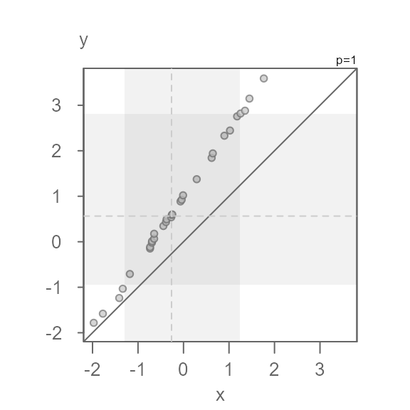

    #>  [1] "Suggested offsets:y = x * 1.4573 + (0.9914)"

- Each point represents matching quantiles from each batch.
- The *shaded region* represents each batch’s middle values ( 75% of
  middle values by default).
- The *dashed lines* inside the shaded boxes represent each batch’s
  medians.
- The *upper right-hand text* indicates the power transformation applied
  to both batches (default is a power of `1` which is original
  measurement scale). If a formula is applied to one or both batches, it
  too will appear in the upper right-hand text.
- The
  [`eda_qq()`](https://mgimond.github.io/tukeyedar/reference/eda_qq.md)
  function will also output the *suggested relationship* between the y
  variable and the x variable in the console. It bases this on each
  batch’s interquartile values.
- If the output is assigned to a new object, that object will store a
  list of the following values: the `x` value (interpolated if needed),
  the `y` value (interpolated if needed), the power parameter (`p`), the
  formula applied to the x variable, and the formula applied to the y
  variable.

## An overview of some of the function arguments

### Data type

The function will accept a *dataframe* with a column of the quantitative
variable of interest, and a column of the category each measurement
belongs to. It will also accept *two separate vector objects*. For
example, to pass two separate vector objects, `x` and `y`, type:

``` r

library(tukeyedar)
set.seed(207)
x <- rnorm(30)
y <- rnorm(30) + 0.5
eda_qq(x, y)
```


If the data are in a dataframe, type:

``` r

dat <- data.frame(val = c(x, y), cat = rep(c("x", "y"), each = 30))
eda_qq(dat, val, cat)
```

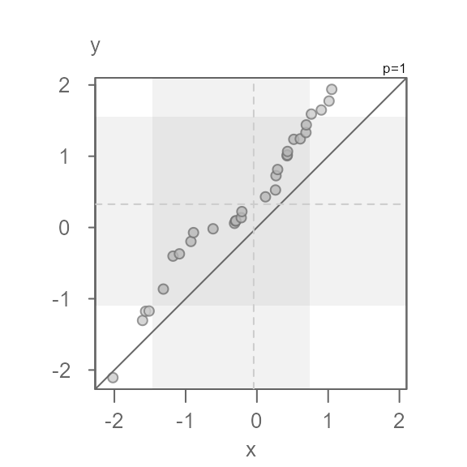

### Suppressing the plot

You can suppress the plot and have the x and y values outputted to a
list in the `data` dataframe. If the batches did not match in size, the
output will show their interpolated values such that the output batches
match in size.

The output will also include the power parameter applied to both batches
as well as any formula applied to one or both batches (`fx` is the
formula applied to the x variable and `fy` is the formula applied to the
y variable).

``` r

Q <- eda_qq(x,y, plot = FALSE)
#>  [1] "Suggested offsets:y = x * 1.12 + (0.5619)"
Q
#>  $data
#>              x           y
#>  1  -2.0207122 -2.10710669
#>  2  -1.6048333 -1.30465821
#>  3  -1.5620907 -1.17618932
#>  4  -1.5128732 -1.17253191
#>  5  -1.3126378 -0.86423268
#>  6  -1.1770882 -0.40162859
#>  7  -1.0871906 -0.37002087
#>  8  -0.9258832 -0.19629536
#>  9  -0.8896555 -0.07210822
#>  10 -0.6152073 -0.01829722
#>  11 -0.3140113  0.05826287
#>  12 -0.2996734  0.09105884
#>  13 -0.2954234  0.09371398
#>  14 -0.2199849  0.13698992
#>  15 -0.2108781  0.22318119
#>  16  0.1202060  0.43006689
#>  17  0.2608893  0.52597363
#>  18  0.2680445  0.72665767
#>  19  0.2910663  0.81351407
#>  20  0.4239690  1.00612388
#>  21  0.4262605  1.01831440
#>  22  0.4301416  1.06713353
#>  23  0.5176361  1.23708449
#>  24  0.6085180  1.24360530
#>  25  0.6880919  1.33232007
#>  26  0.6929772  1.43973056
#>  27  0.7640838  1.59125312
#>  28  0.9037644  1.64852115
#>  29  1.0124869  1.77464625
#>  30  1.0503544  1.93823390
#>  
#>  $p
#>  [1] 1
#>  
#>  $fx
#>  NULL
#>  
#>  $fy
#>  NULL
```

### Defining the grey region

The grey region highlights the core of both batches. By default, this is
set to 75%. Its boundaries can be modified via the `inner` argument.

For example, to highlight the mid 68% of values, type:

``` r

eda_qq(x, y, inner = 0.68)
```

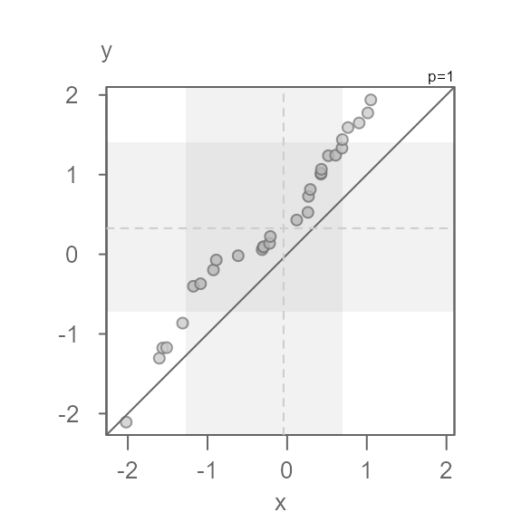

You can suppress the plotting of the shaded region by setting
`q = FALSE`.

### Applying a different symbol to tail-end points

If the grey region is too distracting, but you still wish to identify
the inner core values from the tail-end values, you can set
`tails = TRUE` to enable to the point symbol option, and `q = FALSE` to
remove the grey region.

``` r

eda_qq(x, y, tails = TRUE, q = FALSE)
```

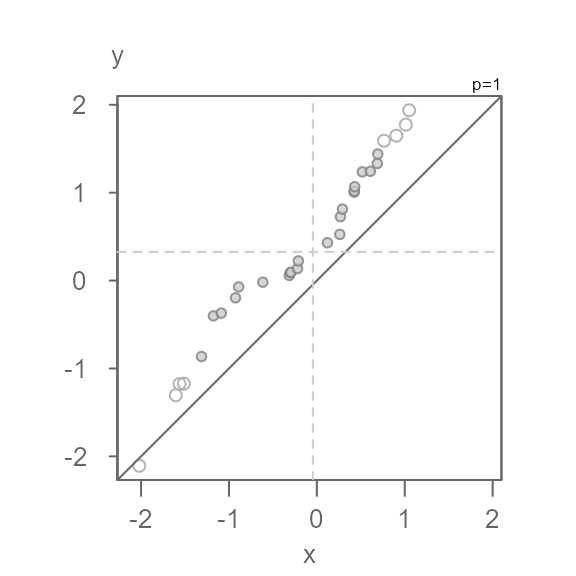

By default, the tail-end points are symbolized using an open point
symbol (as opposed to a filled point symbol applied to the inner core
points). The tail-end point symbol can be modified via the `tail.pch`,
`tail.col` and`tail.fill` arguments. For example, to change the tail-end
point symbol to a `+` symbol, type:

``` r

eda_qq(x, y, tails = TRUE, q = FALSE, tail.pch = 3)
```


If you want greater emphasis to be placed on the inner core points,
change its symbol color. For example:

``` r

eda_qq(x, y, tails = TRUE, q = FALSE, tail.pch = 3, p.fill = "coral3")
```

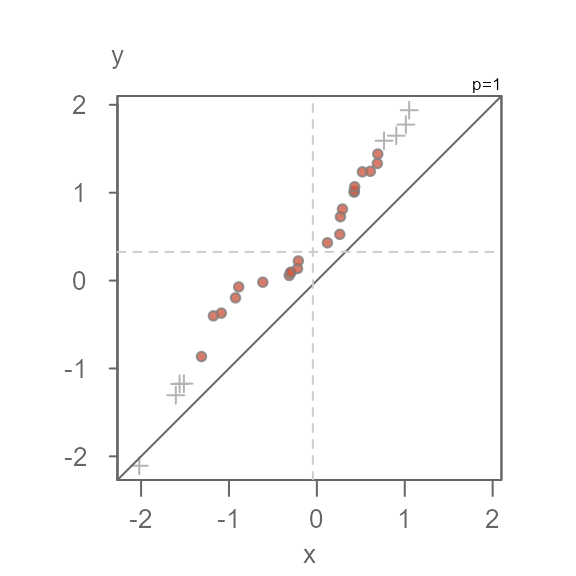

### Applying a formula to one of the batches

You can apply a formula to a batch via the `fx` argument for the
x-variable and the `fy` argument for the y-variable. The formula is
passed as a text string. For example, to add `0.5` to the x values,
type:

``` r

eda_qq(x, y, fx = "x + 0.5")
```

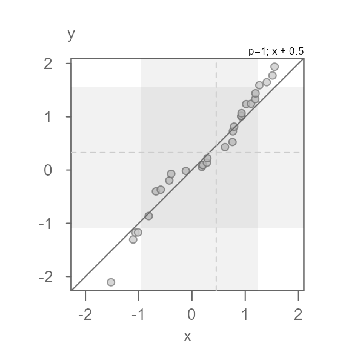

### Quantile type

There are many different quantile algorithms available in R. To see the
full list of quantile types, refer to the quantile help page:
[`?quantile`](https://rdrr.io/r/stats/quantile.html). By default,
[`eda_qq()`](https://mgimond.github.io/tukeyedar/reference/eda_qq.md)
adopts `q.type = 5`. In general, the choice of quantiles will not really
matter, especially for large datasets. If you want to adopt R’s default
type, set `q.type = 7`.

### Point symbols

The default point type, color and size applied to *all* points (or just
the inner core points if `tails = TRUE`) can be modified via the `pch`,
`p.col` (and/or `p.fill`) and `size` arguments. The color can be either
a built-in color name (you can see the full list by typing
[`colors()`](https://rdrr.io/r/grDevices/colors.html)) or the
[`rgb()`](https://rdrr.io/r/grDevices/rgb.html) function. If you define
the color using one of the built-in color names, you can adjust its
transparency via the `alpha` argument. An `alpha` value of `0` renders
the point completely transparent and a value of `1` renders the point
completely opaque. The point symbol can take on two color parameters
depending on point type. If `pch` is any number between 21 and 25,
`p.fill` will define its fill color and `p.col` will define its border
color. For any other point symbol type, the `p.fill` argument is
ignored.

Here are a few examples:

``` r

eda_qq(x, y, p.fill = "bisque", p.col = "red", size = 1.2)
```

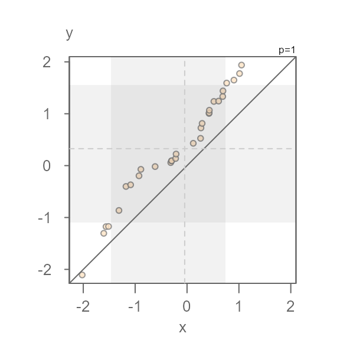

``` r

eda_qq(x, y, pch = 16, p.col = "tomato2", size = 1.5, alpha = 0.5)
```

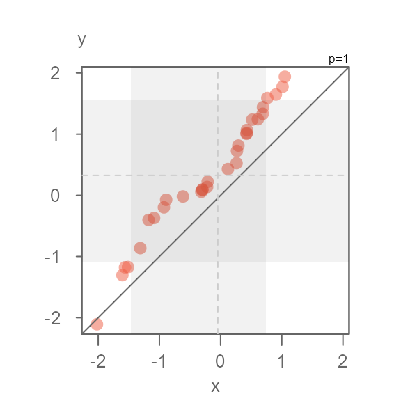

``` r

eda_qq(x, y, pch = 3, p.col = "tomato2", size = 1.5)
```

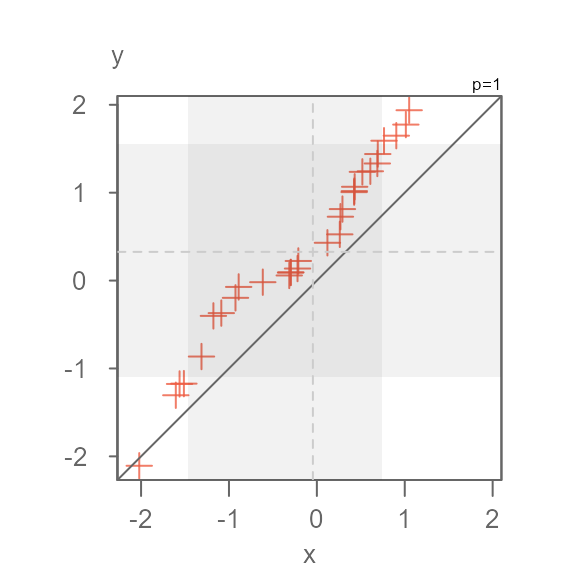

## Interpreting a QQ plot

To help interpret the following QQ plots, we’ll compare each plot to its
matching kernel density plot.

### Identical distributions

In this first example, we will generate a QQ plot of two identical
distributions.

``` r

library(tukeyedar)
set.seed(543)
x <- rnorm(100)
y <- x
eda_qq(x, y)
```

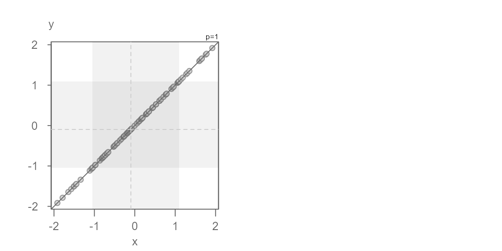

``` r

eda_dens(x, y)
```

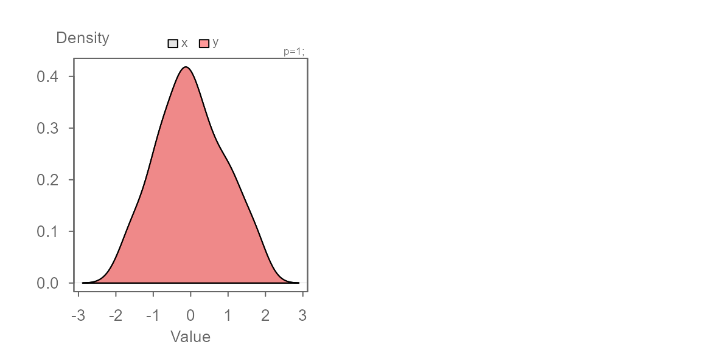

When two distributions are identical, the points will line up along the
\\x=y\\ line as shown above. This will also generate overlapping density
plots as seen on the right plot.

### Additive offset

We will work off of the same batches, but this time we will offset the
second batch, `y`, by `2`. This case is referred to as an **additive
offset**.

``` r

library(tukeyedar)
set.seed(543)
x <- rnorm(100)
y <- x + 2
eda_qq(x, y)
```

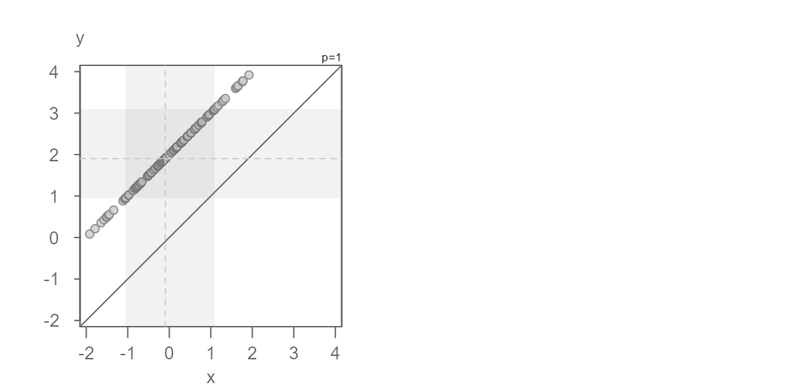

``` r

eda_dens(x, y)
```

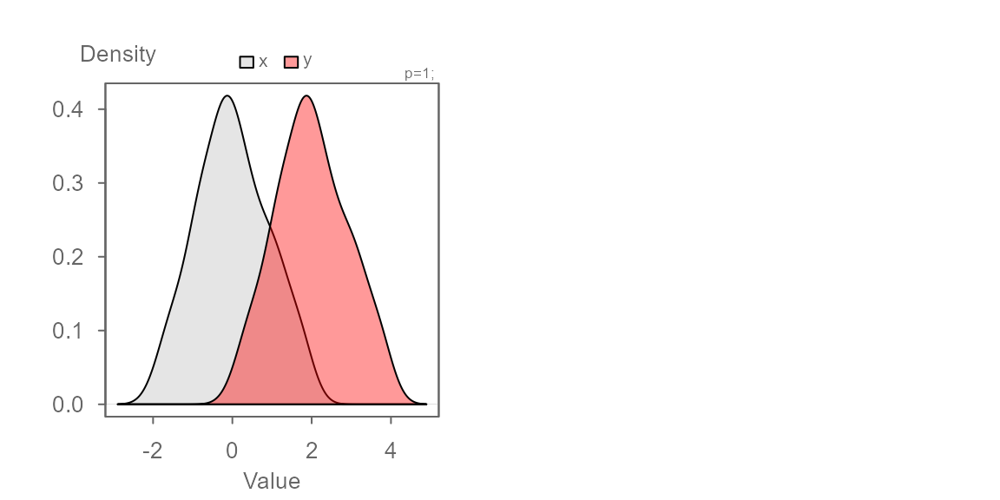

You’ll note that the points are parallel to the \\x=y\\ line. This
indicates that the distributions have the exact same shape. But, they do
not fall on the \\x=y\\ line–they are offset by `+2` units when measured
along the y-axis, as expected. We can confirm this by adding `2` to the
`x` batch:

``` r

eda_qq(x, y, fx = "x + 2")
```

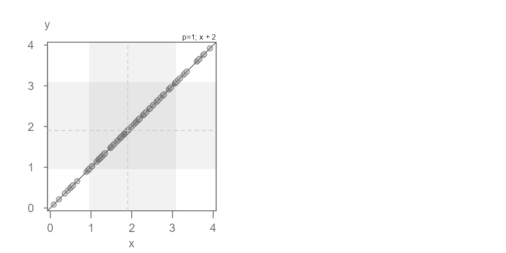

``` r

eda_dens(x, y, fx = "x + 2")
```


The points now overlap the \\x=y\\ line perfectly. The density
distribution overlap exactly as well.

### Multiplicative offset

Next, we explore two batches that share the same central value but where
the second batch is `0.5` times that of the first. This case is referred
to as a **multiplicative offset** (often called a scale or spread
difference).

``` r

y <- x * 0.5
eda_qq(x, y)
```

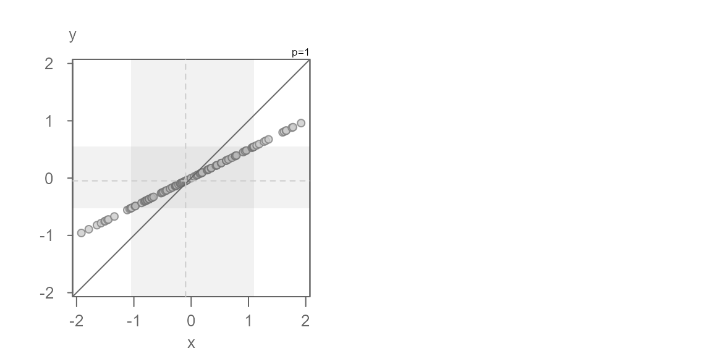

``` r

eda_dens(x, y)
```

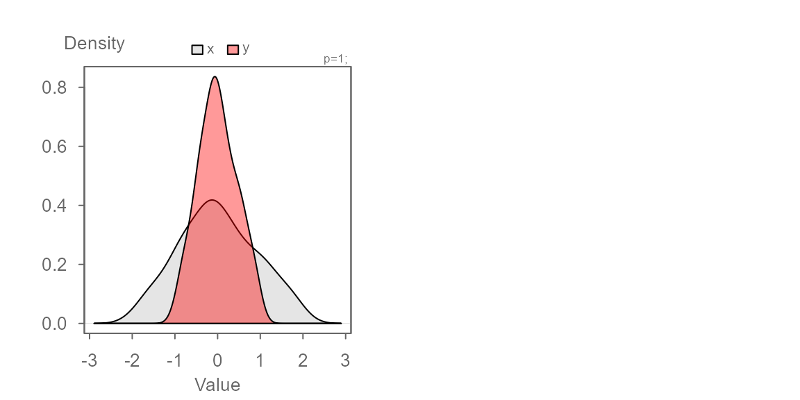

Here, the series of points are at an angle of the \\x=y\\ line yet,
you’ll note that the points follow a perfectly straight line. This
suggests a multiplicative offset with no change in location. This
indicates that the “shape” between the batches are similar, but that one
is “wider” than the other. Here, `y` is half as wide as `x`. We can also
state that `x` is twice as wide as `y`

We know the multiplicative offset since we synthetically generated the
values `x` and `y`. But in practice eyeballing the multiplier from the
plot is not straightforward. We can use the suggested offset of `0.5`
displayed in the console to help guide us. We can also use the angle
between the points and the \\x=y\\ line to judge the direction to take
when choosing a multiplier. If the points make up an angle that is less
than the \\x=y\\ line, we want to choose an `x` multiplier that is less
than `1`. If the angle is greater than the \\x=y\\ line, we want to
choose a multiplier that is greater than `1`.

Here, we know that the multiplier is `0.5`. Let’s confirm this with the
following code chunk:

``` r

eda_qq(x, y, fx = "x * 0.5")
```

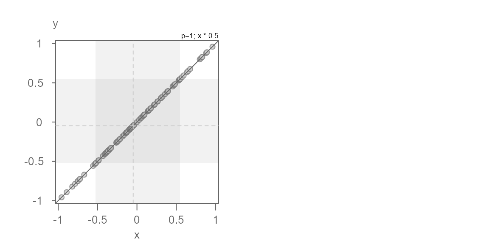

``` r

eda_dens(x, y, fx = "x * 0.5")
```


### Both additive and multiplicative offset

In this next example, we add both a multiplicative *and* an additive
offset to the data.

``` r

y <- x * 0.5 + 2
eda_qq(x, y)
```

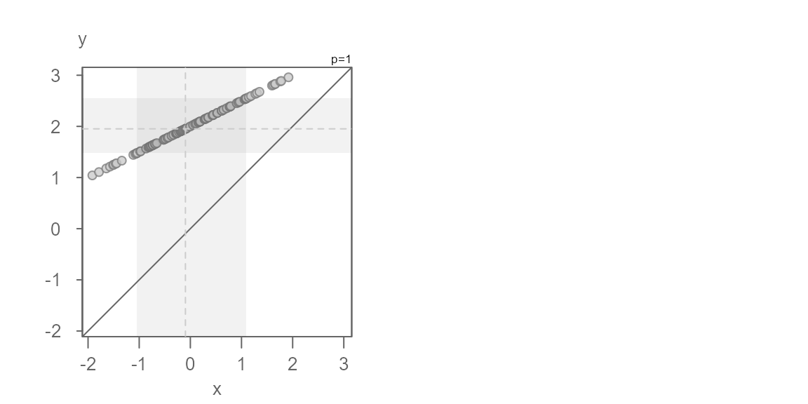

``` r

eda_dens(x, y)
```

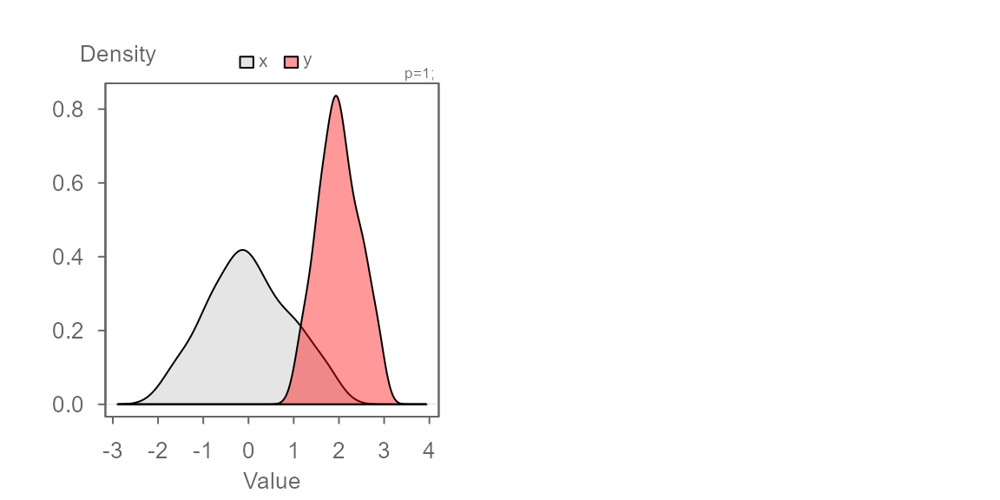

We now see both a multiplicative offset (the points form an angle to the
\\x=y\\ line) and an additive offset (the points do not intersect the
\\x=y\\ line). This suggests that the *width* of the batches differ and
that their values are offset by a constant value across the full range
of values. It’s usually best to first identify the multiplicative offset
such that the points are rendered parallel to the \\x=y\\ line.
Multiplicative differences affect the slope of the quantile
relationship, whereas additive differences affect only its vertical
displacement. Correcting the slope first makes the remaining vertical
displacement easier to assess.

``` r

eda_qq(x, y, fx = "x * 0.5")
```

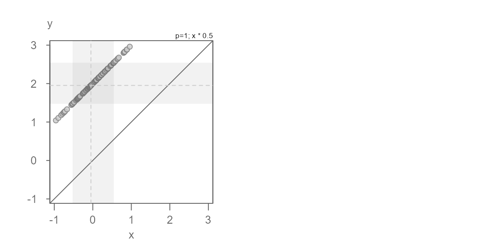

``` r

eda_dens(x, y, fx = "x * 0.5")
```

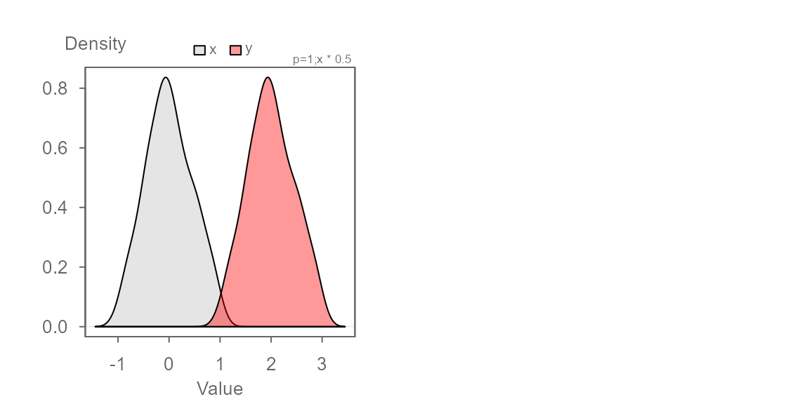

No surprise, the multiplier of `0.5` renders the series of points
parallel to the \\x=y\\ line. We can now eyeball the offset of `+2` when
measuring the distance between any of the points and the \\x=y\\ line
when measured along the y-axis.

``` r

eda_qq(x, y, fx = "x * 0.5 + 2")
```

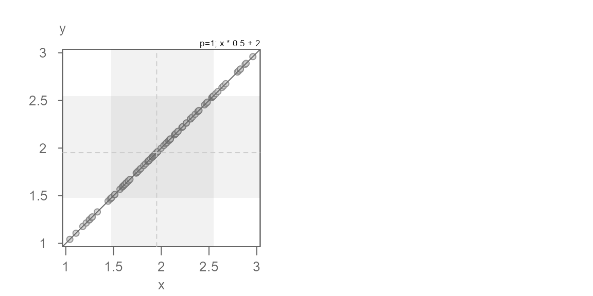

``` r

eda_dens(x, y, fx = "x * 0.5 + 2")
```

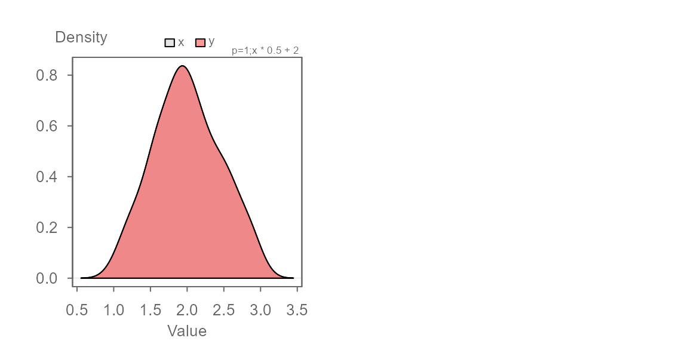

We can model the relationship between y and x as \\y = x \* 0.5 + 2\\.

### Batches need not be symmetrical

So far, we have worked with a normally distributed dataset. But note
that any distribution can be used in a QQ plot. For example, two equally
skewed distributions that differ by their central values will generate
points that are perfectly lined up.

``` r

set.seed(540)
x2 <- rbeta(100, 1, 8)
y2 <- x2 + 0.2 
eda_qq(x2, y2)
```

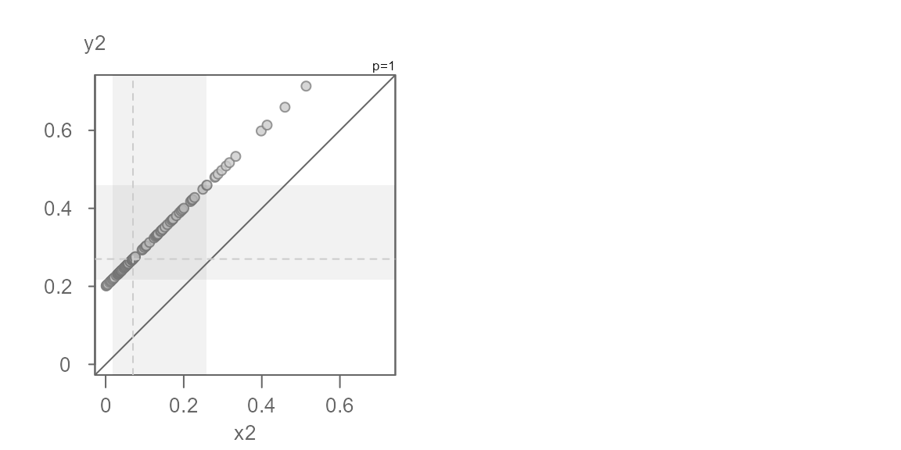

``` r

eda_dens(x2, y2)
```

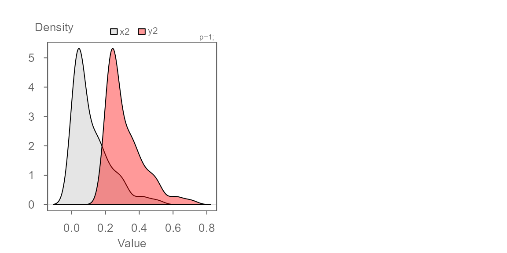

Since both distributions have an identical shape, the points will follow
a straight line regardless of the nature of the shape (skewed, unimodal,
bimodal, etc…).

When distributions are not symmetrical, you should be careful in not
letting the long tails of the distribution bias your interpretation of
the plots given that the tail-end values will take up a
disproportionately larger portion of the plot. Tail-end values tend to
be noisy and will undoubtedly generate a QQ plot that may suggest that
the distributions are inherently dissimilar. For example, if we generate
a plain vanilla plot (i.e. one without the built-in inner core guides)
of two batches pulled from an identical theoretical distribution, we get
the following QQ plot.

``` r

set.seed(18)
x2 <- rbeta(100, 1, 8)
y2 <- rbeta(100, 1, 8)
eda_qq(x2, y2, q = FALSE, med = FALSE)
```

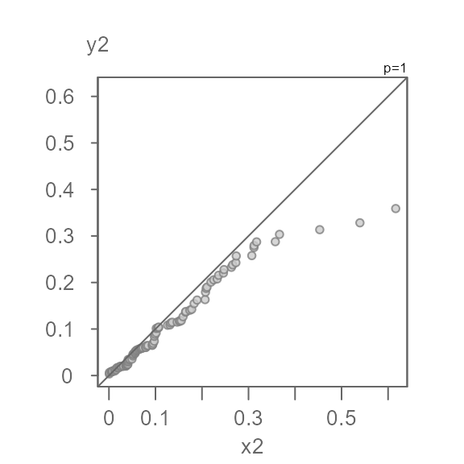

Note how the tail-end values deviate from the \\x=y\\ line. They take up
nearly a third of the plot leading one to place a disproportionate
emphasis on these values. Adding the grey regions and the median value
lines helps us identify the bulk of the data (inner 75% by default).

``` r

set.seed(18)
x2 <- rbeta(100, 1, 8)
y2 <- rbeta(100, 1, 8)
eda_qq(x2, y2)
```

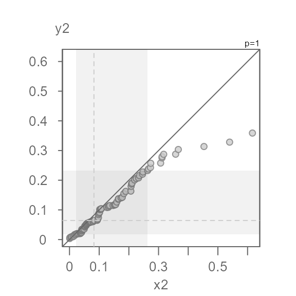

## Power transformation

The `eda_qq` function allows you to apply a power transformation to both
batches. Note that transforming just one batch makes little sense since
you end up comparing two batches measured on a different scale. In this
example, we make use of R’s `Indometh` dataset where we compare
indometacin plasma concentrations between two test subjects.

``` r

s1 <- subset(Indometh, Subject == 1, select = conc, drop = TRUE) # Test subject 1
s2 <- subset(Indometh, Subject == 2, select = conc, drop = TRUE) # Test subject 2
```

``` r

eda_qq(s1, s2)
```

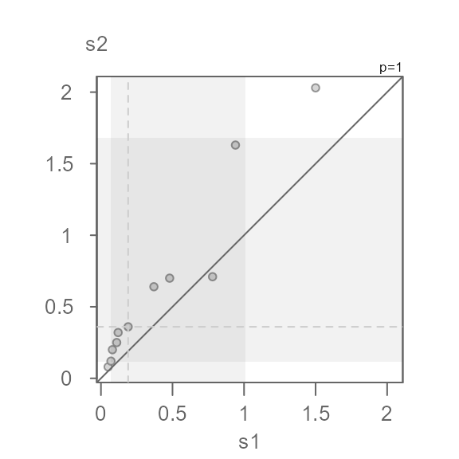

The QQ plot’s shaded regions are shifted towards lower values. The
shaded regions show the mid 75% of values for each batch. In a symmetric
distribution, the median tends to sit near the center of the middle 75%
box. When the median is noticeably displaced toward one edge of the box,
the distribution is typically skewed. Another telltale sign of a skewed
dataset is the gradual dispersion of the points in any of the two
diagonal directions. Here, we go from a relatively high density of
points near the lower values and a lower density of points near higher
values. This does not preclude us from identifying
multiplicative/additive offsets, but many statistical procedures benefit
from a symmetrical distribution. Given that the values are measures of
concentration, we might want to adopt a `log` transformation. The power
transformation is defined with the `p` argument (a power parameter value
of `0` defines a log transformation).

``` r

eda_qq(s1, s2, p = 0)
```

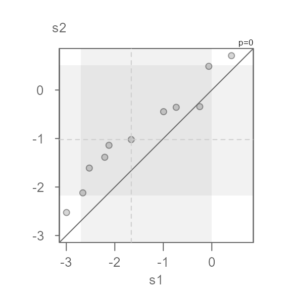

    #>  [1] "Suggested offsets:y = x * 0.8508 + (0.3914)"

This seems to do a decent job of symmetrizing both distributions.

Note that the suggested offset displayed in the console applies to the
transformed dataset. We can verify this by applying the offset to the x
batch.

``` r

eda_qq(s1, s2, p = 0, fx = "x * 0.8501 + 0.3902")
```

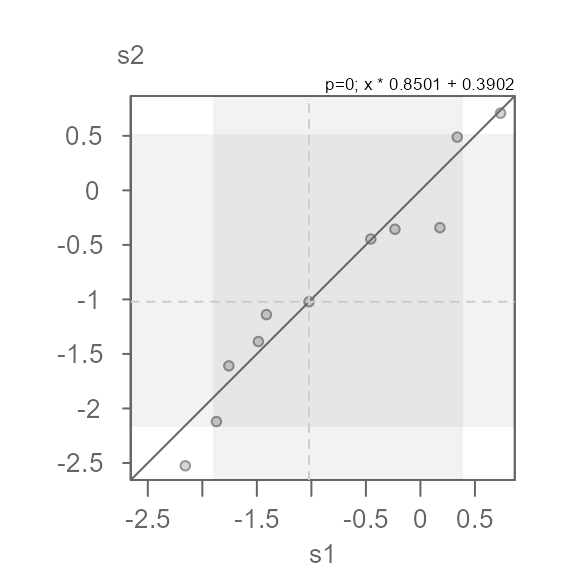

We can characterize the differences in indometacin plasma concentrations
between subject 1 and subject 2 as \\log(conc)\_{s2} = log(conc)\_{s1}
\* 0.8501 + 0.3902\\

## The Tukey mean-difference plot

The **Tukey mean-difference plot** is simply an extension of the QQ plot
whereby the plot is rotated such that the \\x=y\\ line becomes
horizontal. This can be useful in helping identify subtle differences
between the point pattern and the line. The plot is rotated 45° by
mapping the difference between both batches to the y-axis, and mapping
the *mean* between both batches to the x-axis. For example, the
following figure on the left (the QQ plot) shows the additive offset
between both batches but it fails to clearly identify the multiplicative
offset. The latter can be clearly seen in the Tukey mean-difference plot
(on the right) which is invoked by setting the argument `md = TRUE`.

``` r

set.seed(321)
x <- rnorm(10)
y <- x * 0.97 + 0.3
eda_qq(x, y, title = "QQ plot")
```

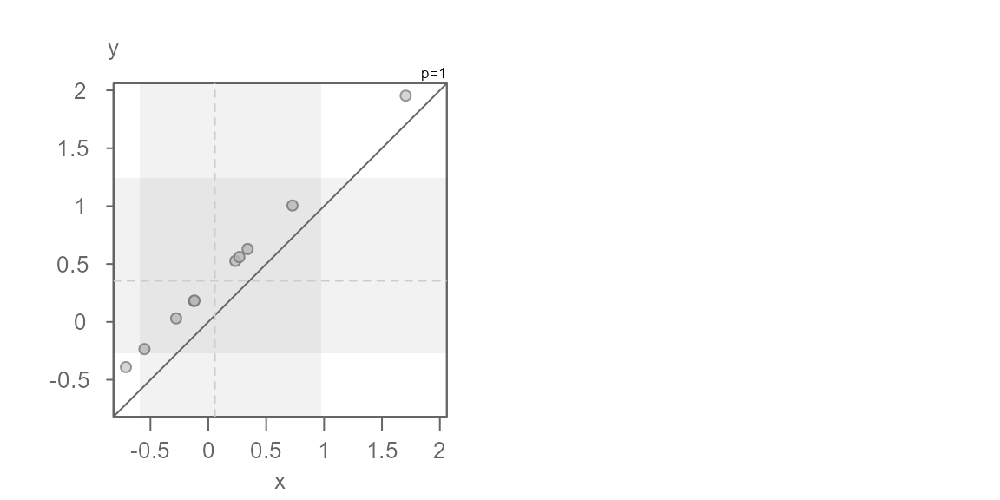

``` r

eda_qq(x, y, md = TRUE, title = "M-D plot")
```

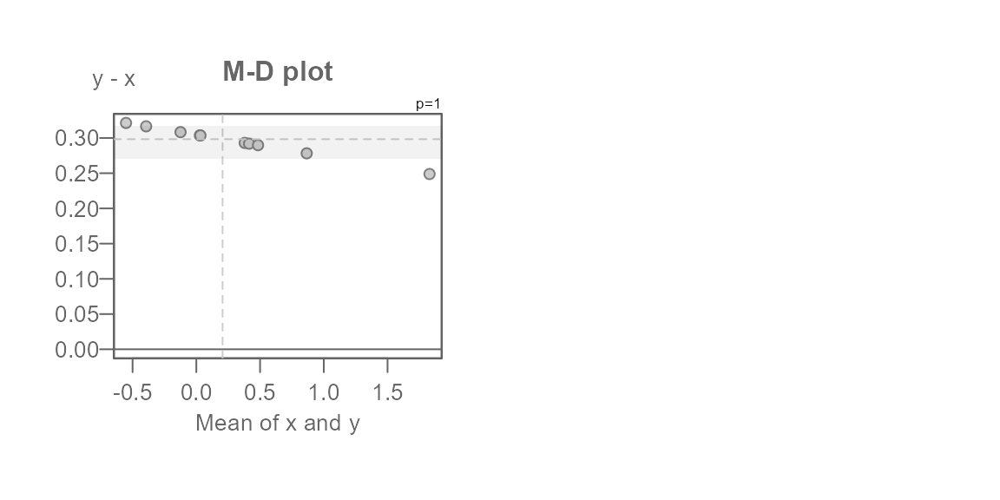

Note that the mean-difference plot highlights the mid *difference*
values defined by the `inner` argument. This does not clearly reflect
the mid values shown in the QQ plot. If you want the mean-difference
plot to show the inner core values, set `tails` to `TRUE`. In doing so,
you might want to disable the shaded region to have most of the emphasis
placed on the points.

``` r

eda_qq(x, y, md = TRUE, tails = TRUE, q = FALSE)
```

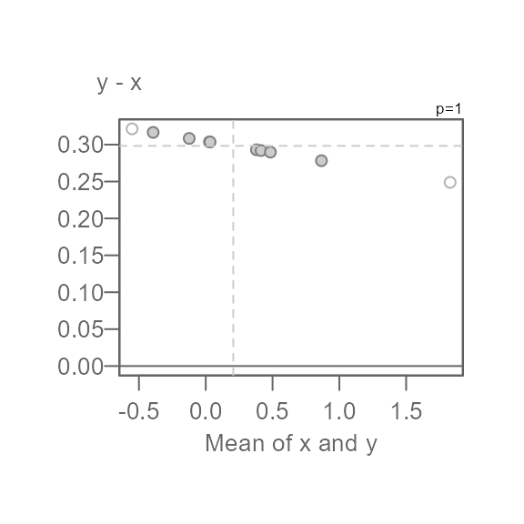

## Assessing pattern vs. noise with permutation envelopes

When comparing two batches in a QQ plot, subtle departures from the \\y
= x\\ reference line (or \\y = 0\\ line in a Mean-Difference plot) often
raise a fundamental question: **Are these differences indicative of real
structural shifts in location, scale, or tails, or are they simply
artifacts of random sampling variability?**

To provide a visual benchmark against chance variation,
[`eda_qq()`](https://mgimond.github.io/tukeyedar/reference/eda_qq.md)
includes an optional **permutation simulation routine** triggered by
setting `nsim > 0`.

### Mechanics of the pooled Permutation

Setting `nsim > 0` constructs a reference envelope under the benchmark
that both batches come from an identical underlying distribution:

- **Pooling and Shuffling:** The observations from both batches (\\x\\
  and \\y\\) are pooled into a single combined sample.
- **Synthetic Reallocation:** For each simulation run, the pooled data
  are randomly permuted and split into two synthetic batches matching
  the original sample sizes (\\n_x\\ and \\n_y\\).
- **Quantile Alignment:** Interpolated quantile pairs are calculated for
  each permuted pair and rendered behind the observed data points. If
  `md = TRUE` is active, the simulated runs are automatically mapped to
  Tukey Mean-Difference coordinates.

### Simulation parameters

The visual appearance of the permutation reference cloud is controlled
by five parameters:

- `nsim`: Number of permutation iterations (default is `0`, which turns
  off simulation).
- `sim.type`: Simulation display type. Either `"points"` (default) or
  `"lines"` for a spaghetti-plot envelope.
- `sim.col`: Color of the simulated reference cloud (default is
  `"coral"`).
- `sim.alpha`: Transparency setting (`0` to `1`).
- `sim.pch`: Plotting symbol used when `sim.type = "points"` (default is
  `16`).

### Interpreting the Reference Cloud

1.  **Within the Cloud:** If the observed quantile points fall
    comfortably inside the concentration of the permuted cloud, the
    variation between the two batches is consistent with what one would
    expect from random sampling alone.
2.  **Beyond the Cloud:** If the observed points curve or step **outside
    the permuted cloud**, it indicates a structural difference between
    the two distributions (such as an additive shift, a difference in
    spread/slope, or heavier tails in one batch).

The following code block displays an empirical QQ plot comparing morning
and afternoon departure delays at Logan airport with a 100-run point
permutation envelope.

``` r

am <- logan[logan$am_pm == "am", "delay"]
pm <- logan[logan$am_pm == "pm", "delay"]
eda_qq(am, pm, nsim=100)
```

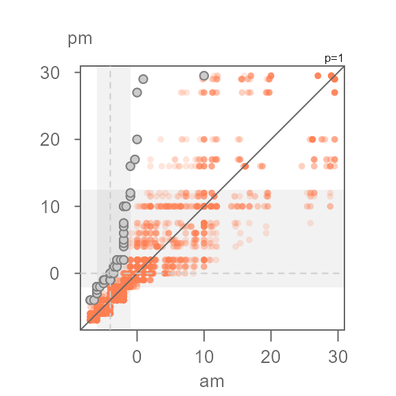

The following code block displays the same data using a spaghetti-plot
envelope.

``` r

eda_qq(am, pm, nsim=100, sim.type = "lines", sim.alpha=0.3)
```


When compared against the 100-run permutation envelope, the observed
quantile points step well outside and above the bounds of the reference
cloud. In exploratory terms, this pronounced departure reveals a clear
location shift: afternoon flight delays are consistently higher across
all quantiles than morning delays. This demonstrates a genuine
structural pattern rather than random sampling noise.

## Creating a QQ plot matrix

A separate function, `eda_qqmat`, is used to create a QQ plot matrix. It
adopts many of the same arguments available in the `eda_qq` function,
but it does not adopt some of `eda_qq`’s default settings. For example,
the inner region shading parameter `q` is set to `FALSE`–this is to
minimize clutter in the densely packed matrix. Instead, points falling
outside of the *inner* region are symbolized with an open point symbol.
For example, to generate an empirical QQ plot matrix of singer height
values conditioned on voice part:

``` r

singer <- lattice::singer
eda_qqmat(singer, height, voice.part)
```

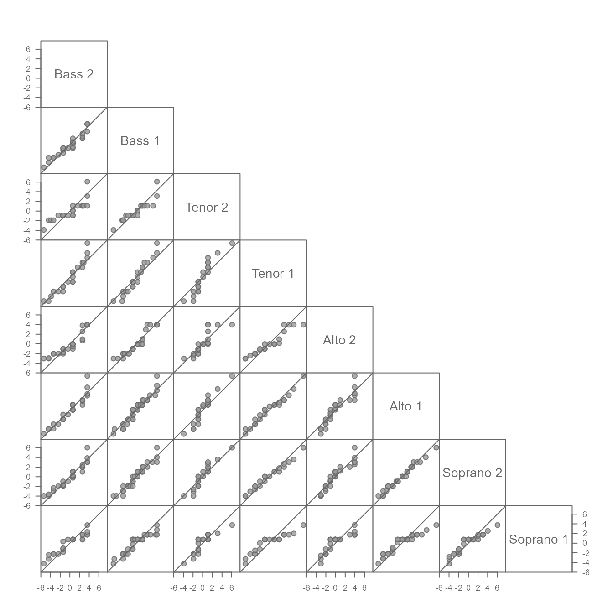

You can, of course, adopt the same point symbol for all points by
setting `tails = FALSE`.

The matrix limits the output to the lower triangle given that the matrix
is symmetrical. If you wish to add the upper triangle, set
`upper = TRUE`.

Additive offsets can be distracting if the goal is to compare spreads
across each group. The function offers the option to generate a
residuals QQ plot matrix (`resid = TRUE`) by subtracting the input
values with the group mean (`stat = mean`) or median (`stat = median`).
For example, to generate a residuals QQ plot of singer height, type:

``` r

eda_qqmat(singer, height, voice.part, resid = TRUE)
```


## A working example

Many datasets will have distributions that differ not only additively
and/or multiplicatively, but also by their general shape. This may
create complex point patterns in your QQ plot. Such cases can be
indicative of different *processes* at play for different ranges of
values. We’ll explore such a case using `wat95` and `wat05` datasets
available in this package. The data represent derived normal
temperatures for the 1981-2010 period (`wat95`) and the 1991-2020 period
(`wat05`) for the city of Waterville, Maine (USA). We will subset the
data to the daily *average* normals, `avg`:

``` r

old <- wat95$avg # legacy temperature normals
new <- wat05$avg # current temperature normals
```

We will now compare their distributions. We’ll omit the shaded region
for now.

``` r

Q <- eda_qq(old, new, q = FALSE)
```

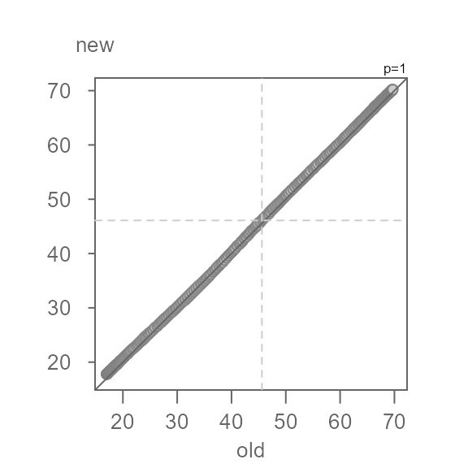

At first glance, the batches do not seem to differ. But how close are
the points to the \\x=y\\ line? We will rotate the plot to zoom in on
the \\x=y\\ line by setting the mean-difference parameter `md` to
`TRUE`.

``` r

Q <- eda_qq(old, new, md = TRUE)
```

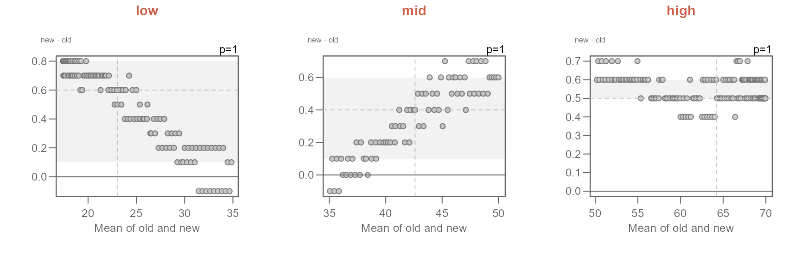

This view is proving to be far more insightful. Note that for most of
the data, we have an overall offset of 0.5 suggesting that the new
normals are about 0.5°F warmer. We could stop there, but the pattern
observed in the Tukey mean-difference plot seems far from random. In
fact, we can break the pattern into three distinct ones at around 35°F
and 50°F. We will categorize these groups as `low`, `mid` and `high`
values. Note that these breakpoints are identified visually from the
mean-difference plot and should be viewed as exploratory partitions
rather than formally estimated thresholds.

This next chunk of code will generate three separate QQ plots for each
range of values.

``` r

labs <- c("low", "mid", "high")
out <- Q$data
out$avg <- (out$old + out$new) / 2
out2 <- split(out, cut(out$avg, c(min(out$avg), 35, 50, max(out$avg)), 
                       labels = labs, include.lowest = TRUE))
sapply(labs, FUN = \(x) {eda_qq(out2[[x]]$old, out2[[x]]$new ,
                                xlab = "old", ylab = "new", md = TRUE)
                         title(x, line = 3, col.main = "orange")} )
```

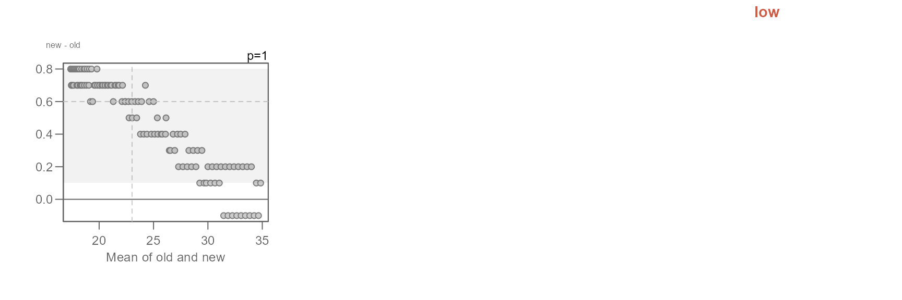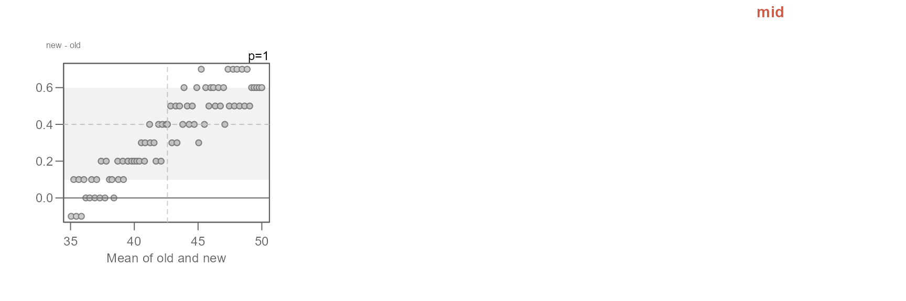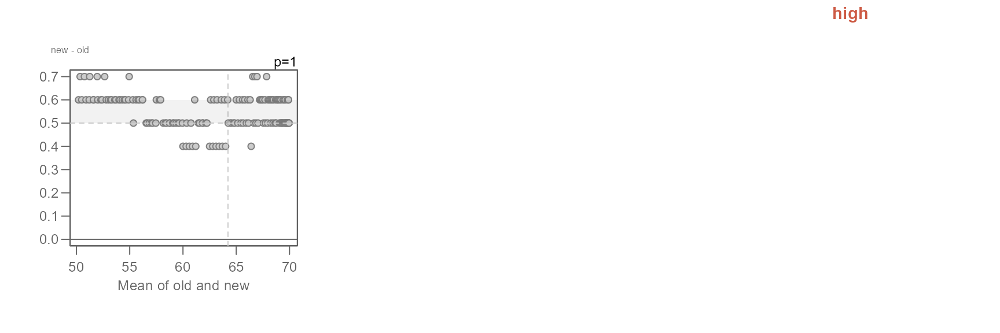

    #>  [1] "Suggested offsets:y = x * 0.9507 + (1.6599)"
    #>  [1] "Suggested offsets:y = x * 1.047 + (-1.6502)"
    #>  [1] "Suggested offsets:y = x * 0.9938 + (0.9268)"

The suggested offsets are displayed in the console for each group.

> It is important to note that we are splitting the paired values
> generated from the earlier `eda_qq` function (`out$avg`) and *not* the
> values from the original datasets (`old` and `new`). Had we split the
> original data prior to combining them with `eda_qq`, we could have
> generated different patterns in the QQ and Tukey plots. This is
> because this approach could generate different quantile pairs.

Next, we’ll adopt the suggested offsets generated in the console.

``` r

xform <- c("x * 0.9507 + 1.661",
           "x * 1.047  - 1.650",
           "x * 0.9938 + 0.9268")
names(xform) <- labs
sapply(labs, FUN = \(x) {eda_qq(out2[[x]]$old, out2[[x]]$new, 
                                fx = xform[x],
                                xlab = "old", ylab = "new", md = TRUE, title = x)
                        })
```

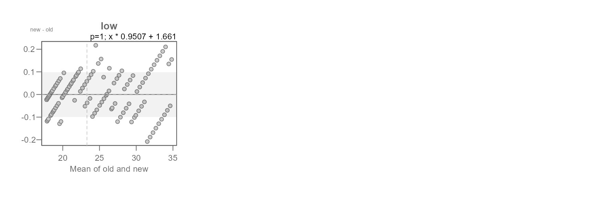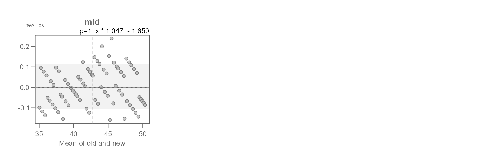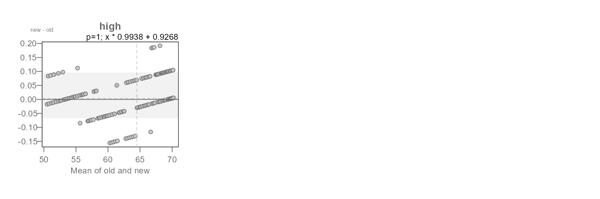

The proposed offsets seem to do a good job in characterizing the
differences in temperatures.

The characterization of the differences in normal temperatures between
the old and new set of normals can be formalized as follows:

\\ new = \begin{cases} old \times 0.9507 + 1.661, & T\_{avg} \< 35 \\
old \times 1.047 - 1.650, & 35 \le T\_{avg} \< 50 \\ old \times 0.9938 +
0.9268, & T\_{avg} \ge 50 \end{cases} \\

It’s important to recall that these equations characterize the
relationship between **corresponding quantiles** in the two
distributions rather than **day-to-day temperature pairs**.

The key takeaways from this analysis can be summarized as follows:

- Overall, the new normals are about 0.5°F warmer.
- Non-uniform Offset: The magnitude and nature of the difference vary
  across temperature ranges:
  - Low Temperatures (\\\< 35^\circ\text{F}\\): The new normals have a
    slightly narrower distribution (\\b = 0.95\\), being roughly
    \\0.9^\circ\text{F}\\ warmer at lower values and tapering down to
    nearly \\0.2^\circ\text{F}\\ warmer as temperatures approach
    \\35^\circ\text{F}\\.
  - Mid Temperatures (\\35^\circ\text{F}\\ to \\50^\circ\text{F}\\): The
    new normals show a slightly wider distribution (\\b = 1.05\\),
    transitioning from identical temperatures at \\35^\circ\text{F}\\ to
    being about \\0.7^\circ\text{F}\\ warmer at \\50^\circ\text{F}\\
    (averaging \\\sim 0.3^\circ\text{F}\\ to \\0.4^\circ\text{F}\\
    warmer overall).
  - High Temperatures (\\\ge 50^\circ\text{F}\\): The distribution shape
    is nearly identical (\\b \approx 0.99\\), with the new normals
    consistently hovering around \\0.5^\circ\text{F}\\ to
    \\0.6^\circ\text{F}\\ warmer.
